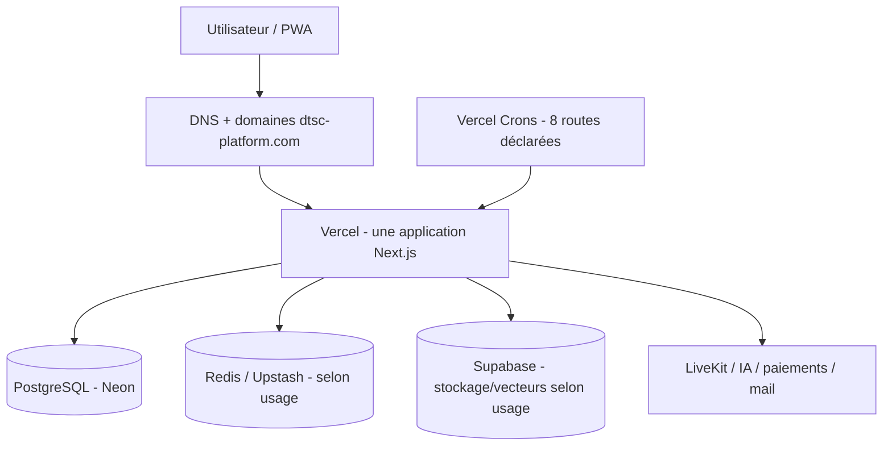
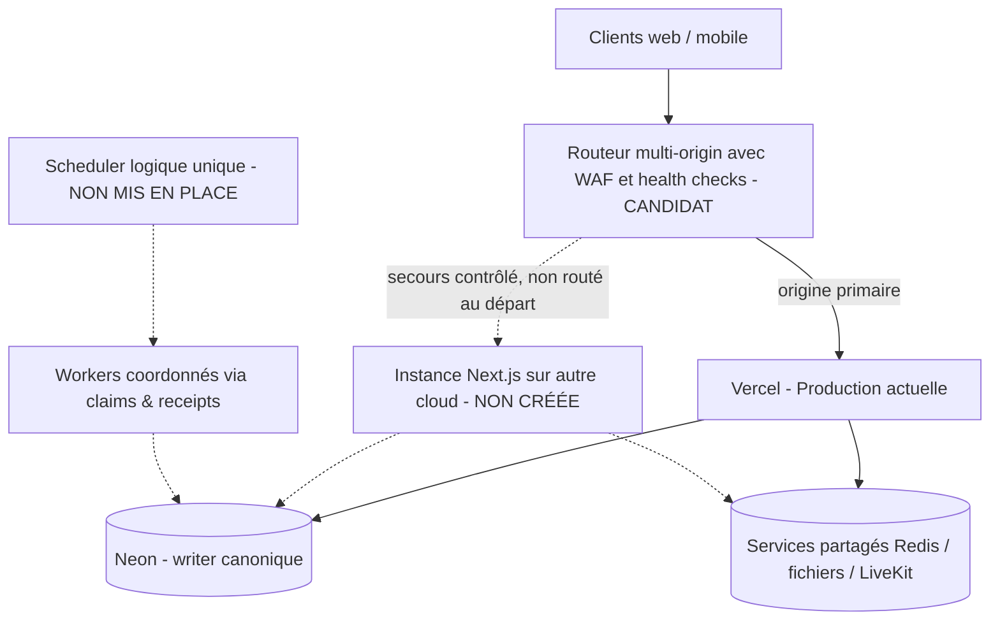

# DTSC INFRA-MC-01 — Audit d'architecture et ADR de continuité multi-cloud

> **Document de cadrage, PAS une autorisation de déploiement.** Issue #892, programme #891.
> **Statut ADR : PROPOSÉ / décision d'exploitation NON APPROUVÉE.**
> **Inspection : 21 octobre 2026.** Référence source GitHub `main@535f9786686a248f0c2454fe2ab3a28981df5a92`. Toute réalisation doit revérifier le dernier `main`.
> Les constats marqués **Code**, **Vercel**, **Neon**, **Supabase** proviennent d'une lecture effective. **À CONFIRMER** indique ce qui n'a pas été testé ou lié à l'environnement Production par une preuve.

## 1. Question et périmètre

Comment exécuter *le même* DTSC Platform simultanément sur plusieurs instances et, à terme, chez plusieurs hébergeurs, en préservant identité, sous-domaines, cohérence applicative et intégrité ERP ? **Multiplier les déploiements n'est ni synonyme de disponibilité inter-cloud ni une garantie de continuité de la base transactionnelle.** Ce document est l'audit initial et la proposition de décision, **pas** une certification des huit lots.

**Invariants non négociables :** une application Next.js/Prisma canonique ; écritures Finance/ERP/Health/Pharmacy sous membership, `organizationId`, entitlements et RBAC serveur ; une seule autorité d'écriture transactionnelle tant qu'aucune autre architecture n'est certifiée ; aucune duplication de workflows, paiements, factures, écritures `POSTED` ou clôtures ; pas de fuite de données de santé ou de secrets ; production uniquement sur `main` après gates et `OWNER_E2E`.

## 2. Carte d'existant avec preuves et limites

| Dimension | Constat vérifié | Source | Incidence / inconnue |
|---|---|---|---|
| Application | Next.js **15.3.8**, React, Prisma 6, Next App Router et `next start` disponibles ; projet unique. | **Code** `package.json`, `AGENTS.md` | Portabilité Node plausible, **non testée** sur un autre cloud. |
| Production | Projet Vercel **`dtsc-platform`**, dernier déploiement `READY` lié à `main@535f978` au moment de l'inspection. | **Vercel** project et deployments, 21/10/2026 | `READY` n'est pas une mesure de SLO, de HA inter-cloud ou de santé métier. Région effective des Functions **à confirmer** dans Settings. |
| Politique de release | Branche `main` seule autorisée ; preview branches désactivées, `vercel.sh` rejette les autres environnements/réfs. | **Code** `vercel.json`, `vercel.sh`, `docs/DELIVERY_GOVERNANCE.md` | Préserver cette discipline ; aucun secondary auto-deploy avant définition du gate. |
| Compilation | `vercel.sh` exécute `pnpm prisma:generate`, QA runtime Prisma, puis **`pnpm prisma migrate deploy`** avant `pnpm build` ; P1001 retry borné. | **Code** `vercel.sh` | **P0 de conception :** retirer les migrations du build de chaque origine avant release multi-cloud ; un orchestrateur unique de migrations avec compatibilité N/N-1 (#895). Aucun changement de ce comportement dans #892. |
| Version Node | `package.json` annonce `22.x`, projet Vercel affiche `24.x`. | **Code + Vercel** | **Écart de configuration observé**, pas une panne démontrée : clarifier résolution effective des versions / alignement avant packaging (#893). |
| Routes | `public`, `account`, `app`, `console`, `support` dans le même bundle et les mêmes routes `/api/*`, avec routage par Host. | **Code** `lib/domains.ts`, `middleware.ts` et `docs/ROUTING_AND_SUBDOMAINS.md` | Multi-origin doit transmettre Host, HTTPS, forwarded headers fiables, same-origin, chemins API et redirections sans permettre d'open redirect. |
| Domaines | Vercel rattache `dtsc-platform.com`, `www`, `app`, `account`, `console`, `support`, ainsi que `docs`, `status`, `academy`, `partners`, `community`, `developers` et alias Vercel. | **Vercel** projet, 21/10/2026 | Les domaines supplémentaires ne sont **pas** des produits couverts par le `HostType` canonique ; **ne pas** leur attribuer automatiquement un nouvel hôte/route secondaire. Cartographie à terminer (#892/#898). |
| Cookies/auth | Cookie `dtsc_session` signé via `AUTH_SECRET` ; `httpOnly`, `sameSite=lax`, domaine partagé si `AUTH_COOKIE_DOMAIN`. Contextes `DTSC_INTERNAL`, `ORGANIZATION`, `GLOBAL_CLIENT`. | **Code** `lib/auth.ts`, `middleware.ts`, `lib/domains.ts` | Tous les nœuds doivent vérifier les mêmes sessions et respecter durée, révocation, changement de tenant, origin/CSRF ; secret uniquement serveur (#894). |
| Jobs programmés | **8 routes Cron** : workflows, projections cross-module, Web Push, emails d'administration, index connaissances, bulk entreprise, rapports planifiés, expiration identity-links. | **Code** `vercel.json` | Un deuxième scheduler naïf doublerait les tentatives ; verrouiller les déclenchements à une autorité logique, worker claims et reprise sans double effet (#895). |
| Protection des Crons | Workflows protégé par `WORKFLOW_WORKER_ENABLED` et `WORKFLOW_EVENT_CUTOVER_AT`; sept autres ont des opt-in individuels quand le secret commun est employé. | **Code/doc** `docs/WORKFLOW_RUNTIME_RECOVERY.md`, #861 | **Ne pas activer** des flags ni un `CRON_SECRET` commun à la légère ; traiter backlog historique par classes et autorisation. Config Production réelle **non vérifiée** pendant cet audit. |
| Reprise des workflows | Lease **90 s**, `SKIP LOCKED`, CAS, fencing/reçus ; `UNCERTAIN` bloque tout replay aveugle. | **Doc/Code** `docs/WORKFLOW_RUNTIME_RECOVERY.md` | Vérifier sur base de test 12+ workers et collisions multi-origines ; les règles de récupération restent obligatoires. |
| PostgreSQL | Projet **Neon nommé `dtsc-platform`** trouvé, région `aws-us-east-1`, PostgreSQL **17**, rétention historique affichée **21 600 s (6 h)**, `enable_logical_replication=false` ; paramètres autoscaling 0,25–8 CU. | **Neon** inventaire projets, 21/10/2026 | **Association exacte à la DATABASE_URL Production à confirmer** sans lire/révéler les credentials. La fenêtre d'historique **n'est pas une preuve de sauvegarde restaurable, de PITR suffisant ni un RPO de 6 h**. Pooling, DR, protections et contrats d'écriture à auditer (#896). |
| Supabase | Un projet connecté affiché `ACTIVE_HEALTHY` en **`eu-west-1`** ; dépendances Supabase dans le code et la CSP. | **Supabase** inventaire projets ; **Code** `package.json`, `next.config.ts` | Son association exacte aux objets privés DTSC Production, les buckets, policies, réplication et restauration **restent à confirmer** ; évaluer transatlantique DB ↔ storage (#896). |
| Redis | Le programme SCALE décrit Redis / Upstash pour présence, limites et états éphémères ; endpoint et région actifs non contrôlés. | **Code/docs** #352, docs techniques, `next.config.ts` | Disponibilité et propagation multi-région/rate-limit **non prouvées** (#894/#896). |
| Providers externes | CSP autorise LiveKit, Supabase, Upstash, API IA, Zoho et MaishaPay ; middleware traite explicitement des callbacks MaishaPay/Zoho. | **Code** `next.config.ts`, `middleware.ts` | Vérifier les vraies intégrations et leurs webhooks/callbacks, signature, idempotence, replay, flux audio/vidéo et changement d'origine (#892/#898). Autorisation CSP ≠ preuve d'utilisation active. |

### Sous-domaines et autorité métier

| Domaine logique | Hôte canonique | Parcours à préserver sur basculement | Protection critique |
|---|---|---|---|
| Public | `dtsc-platform.com` (+ `www`) | statique/SSR, SEO, formulaires publics, assistant public | aucune donnée privée en CDN |
| Account | `account.dtsc-platform.com` | inscription/login, réorientation `next`, changement de contexte, logout | cookie commun, CSRF/same-origin, redirections fiables |
| App | `app.dtsc-platform.com` | dashboard, entreprise, ERP, collaboration, IA et PWA | membership, module, entitlement, RBAC, `organizationId` |
| Console | `console.dtsc-platform.com` | administration interne `/admin` | `DTSC_INTERNAL` + `dtsc-internal` ; jamais un bypass rôle global |
| Support | `support.dtsc-platform.com` | tickets et pièces volontairement partagées | scopes utilisateur/organisation |
| APIs | `/api/*` sur les hôtes existants | mutations ERP, auth, webhooks, Crons | signature externe, anti-doublon, middleware serveur, audit |
| Sites annexes | `docs`, `status`, `academy`, `partners`, `community`, `developers` | **À CARTOGRAPHIER** avant tout changement de DNS | ne pas considérer ces sous-domaines couverts par les cinq `HostType` sans preuve |

## 3. Topologie actuelle et scénarios examinés

### État actuel (simplification d'audit)

Les régions et l'association exacte de chaque provider au runtime Production doivent être prouvées via accès opérateur, pas inférées d'un paquet importé.

### Options comparées (à l'état de proposition)

| Option | Points forts | Limites / conditions | Verdict à ce stade |
|---|---|---|---|
| **A. Vercel multi-instances / éventuellement multi-région** | Peu de changements applicatifs, exploitation simple, autoscaling déjà fourni par Vercel | N'élimine **pas** dépendance au fournisseur Vercel ; région Functions à confirmer ; base commune toujours SPOF ; coûts et disponibilité des options selon plan | **Baseline**, pas un secours inter-fournisseur |
| **B. Vercel primaire + Node secondaire indépendant, *active-passive*** | Déploiement isolé et basculement contrôlé possibles ; évite une mutation de deux versions à la fois | Portabilité, sessions/caches, migration unique, WAF/LB, connexions DB, secrets, payloads webhooks, tests de failover obligatoires ; données partagées restent SPOF | **Architecture de référence proposée**, sous réserve des gates et décisions ci-dessous |
| **C. Vercel + second cloud *active-active*** | Répartition simultanée et tolérance à la perte d'une origine applicative | Synchronisation de versions, Next Server Actions et cache tags, protection contre double effet, capacité DB, egress et latence, rollback complexe | **NO-GO par défaut** jusqu'à #899 et validation explicite de preuve |

**Principe de reprise :** perdre Vercel ne garantit pas d'être opérationnel si PostgreSQL, DNS/LB, Redis, Supabase ou le fournisseur de paiement sont eux-mêmes indisponibles. Séparer les scénarios « panne de serveur », « panne de fournisseur applicatif » et « perte de la source de données ». Les writes Finance et Health doivent échouer en sécurité lorsque leur autorité est indisponible.

## 4. Registre des risques et lots responsables

| ID / gravité de conception | Risque à prouver/résoudre | Contrôle bloquant | Issue |
|---|---|---|---|
| R1 — **Critique** | Migrations `prisma migrate deploy` actuellement couplées à chaque build Production | Un pipeline release unique ; migrations additives compatibles N/N-1 ; tests depuis DB vierge et de rollback | #895 |
| R2 — **Critique** | Huit Crons déclenchés par plusieurs fournisseurs / `CRON_SECRET` partagé | Scheduler logique unique, flags off, claims atomiques, backlogs audités, tests 12+ workers | #895 |
| R3 — **Critique** | Double impact Finance/ERP après retry de requête, webhook ou failover | Idempotence canonique, reçus, pas de retry aveugle des mutations, tests collision et audit | #895, #898, #899 |
| R4 — **Critique** | Session/organisation/role incohérent à la bascule, fuite tenant | Validation signed cookie et RBAC serveur par nœud, révocation, origine/Host fiable, tests cross-tenant | #894, #898 |
| R5 — Élevée | PostgreSQL unique et restauration non prouvée ; historique Neon affiché 6 h | Confirmer endpoint productif, politiques de sauvegarde, restauration test isolée, RPO/RTO observés, single writer | #896 |
| R6 — Élevée | Next.js Server Actions, build/version skew, cache invalide entre nœuds | Même artefact/SHA, encryption key Server Actions conforme version, deployment ID, handler de cache partagé et invalidation multi-instances si utilisé | #893, #894 |
| R7 — Élevée | Décalage Node 22 code / 24 projet Vercel | Revue et certification versions/runtime avant artefacts de secours | #893 |
| R8 — Élevée | Latence applicative et coûts DB ↔ autres régions | Mesurer P95/P99, pool Prisma, flux interrégion et egress en données synthétiques | #892, #896, #899 |
| R9 — Élevée | Basculement d'origine HTTP/DNS casse cookie, Host, CSP, PWA, callbacks | Health + canary, DNS/TLS/WAF, conformité API/cookies/hôtes ; validation des domaines annexes | #897, #898, #899 |
| R10 — Élevée | Stockage privé, vecteurs, LiveKit ou provider de paiement indisponible | Matrice de dégradation sûre, rétention/restore, webhooks signés, tests sous panne partielle | #896, #899 |
| R11 — Élevée | Divergence entre `main`, Vercel et conteneur secondaire | Publication depuis SHA approuvé, artefact immuable, digest, rollback, gate opérateur avant promotion | #893, #897, #899 |
| R12 — Moyenne | Fausse haute disponibilité par health check `200` superficiel | Distinction liveness vs readiness par fonction, sondes bornées, métriques métier et anti-flapping | #897, #898 |

Les `AGENTS.md` et sources de vérité ERP/Finance priment sur tout mécanisme de basculement ; **aucune réponse 200 d'une sonde n'autorise une écriture financière**.

## 5. Registre des décisions à valider (aucune valeur inventée)

| Décision | Valeur proposée / état réel | Décideur à confirmer | Preuve demandée |
|---|---|---|---|
| Stratégie initiale | **PROPOSÉ : active-passive**, Vercel primaire, une origine indépendante de secours, aucune bascule DNS avant #898 | CEO + CTO | ADR acceptée et OWNER_E2E |
| Fournisseur secondaire | **À DÉCIDER** : solution Node managée ou VM conteneurisée ; évaluer au moins deux candidats par coût, simplicité, sécurité et HA | CTO / exploitation, arbitrage CEO | comparaison et pilote isolé #897 |
| Région secondaire | **À DÉCIDER** après mesure région Vercel effective, proximité PostgreSQL, résidence, latence depuis RDC et contraintes de santé | CTO + responsable sécurité | mesures multi-région et conformité |
| RTO origine applicative | **NON DÉFINI** ; chronométrer détection + routage + reprise de session | CEO/CTO | cible signée puis tests #898/#899 |
| RTO panne DB et restauration | **NON DÉFINI** ; séparé de la panne origine | CEO/CTO + exploitation données | restore testé #896 et #899 |
| RPO ERP/Finance/Health | **NON DÉFINI** ; pas de valeur « 0 » tant que transaction/réplication/recovery ne la prouvent | CEO/CTO + responsables métiers | restauration isolée, journal/écritures audités |
| SLO/API | **Seuils SCALE #352** à conserver : P95 CRUD <1 s, P99 critique <2 s hors fournisseurs externes, erreurs <1 %, isolement 100 %. | Gouvernance SCALE #352 | certifications reproductibles, pas seulement docs |
| Capacité | **5 000 actifs simultanés : non certifiés par le seul programme INFRA-MC** ; #360 doit publier ses propres preuves. | CTO / programme SCALE | rapports d'essai par palier |
| Budget mensuel / egress / sauvegarde | **NON DÉFINI** ; aucune dépense engagée par ce document | CFO/HR + CEO + CTO | devis réels et plafond autorisé |
| DNS, LB, WAF et TLS | **NON CHOISI** ; Cloudflare LB est un **candidat technique**, non un produit installé | CTO + propriétaire du domaine | conception, compatibilité Host/TLS/cookies, rollback |
| Seuil GO/NO-GO | **NO-GO par défaut** si un P0/P1, effet financier en double, fuite tenant, mauvaise sauvegarde, RPO/RTO non prouvés ou OWNER_E2E manquant | CEO + CTO | signatures et jeux d'essais réels |

### Historique SCALE : ne pas confondre mesure archivée et performance actuelle

Les issues #360/#788 conservent des essais **500 VUs** d'octobre 2026 en échec. Par exemple, #788 rapporte sur le run archivé du 10 octobre un global P95 **1 069,17 ms** et P99 **2 642,15 ms**, et un Dashboard P99 **3 691,27 ms**, malgré isolation tenant 100 % et HTTP 0 % sur cet essai. **Ce n'est ni un monitoring instantané ni un résultat multi-cloud.** Revalider sur le SHA actuel et ne pas assouplir les gates SCALE ; #899 réutilise les résultats lorsque certifiés.

## 6. Contrats spécifiques à certifier avant un double déploiement

### Build/runtime Next.js (#893/#894)

- Construire un **même artefact immutable** pour les deux nœuds ; garantir version, gestion de l'encryption Server Actions, deployment ID/version skew et compatibilité middleware/SSR/streaming/PWA.
- Tester sessions et navigations entre `account`, `app`, `console`, `support`, plus les hôtes annexes s'ils sont réellement servis.
- Inspecter `revalidateTag`/ISR/cache par version Next.js 15.3.8 : un cache propre à un conteneur **ne constitue pas** un cache invalidé globalement. Exiger tests multi-nœuds avant un routage mixte.
- Conserver les contrôles CSRF/origin, headers forwardés, cookie domain, limites d'API et absence de données privées dans le CDN.

### Données et exécution distribuée (#895/#896)

- **Migration = une seule étape de release** avant les applications compatibles ; jamais un `prisma migrate deploy` à chaque build sur plusieurs clouds.
- **Scheduler = une seule autorité logique** ; workers concurrents uniquement avec claims/fencing/receipts canoniques et flags `false` avant activation autorisée.
- **Postgres = un seul writer canonique** ; read replicas n'autorisent pas deux instances à publier une même écriture deux fois.
- Documenter les actions `UNCERTAIN` (échec après effet externe) : ne pas tenter de les réparer par replay aveugle ou SQL de statut.
- Tester la restauration hors Production sur données synthétiques/sanitizées ; ne jamais dériver la sécurité d'une seule fenêtre d'historique affichée par le fournisseur.

### Règles de sécurité et d'exploitation (#897/#898/#899)

- Aucune clé d'auth, valeur `DATABASE_URL`, secret Cron/webhook, URI signée ou contenu médical n'est enregistré dans ce document, dans une PR ou un artefact.
- Toute bascule exige : **deux origines saines**, même version attendue, schéma compatible, flags workers adaptés, échec sécurisé de toute écriture si PostgreSQL n'est pas accessible, critères de rollback et responsable nommé.
- Ne jamais effectuer des `POST` financiers automatiques depuis un health checker ni une relance aveugle côté LB.
- Les dashboards `Administration DTSC > CTO > Scalabilité` agrègent les signaux mesurés de disponibilité, origine, latence, pool SQL, Redis, files/worker, état failover, RPO/RTO d'exercice et version SHA ; aucune donnée patient, client ou identifiant tenant.

## 7. Plan de coupure et de retour arrière (aucune action autorisée dans #892)

1. **#892** : auditer et obtenir signatures CTO/CEO, RTO/RPO/budget/choix région. En l'absence de ces données : ADR = PROPOSÉ.
2. **#893–#894** : prouver artefact Node commun, sessions/revalidation entre deux processus dans **un environnement isolé** ; ne pas toucher Vercel Prod.
3. **#895** : prouver migration unique et concurrence safe sur **PostgreSQL de test**, pas de remise en route du backlog.
4. **#896** : restaurer backups dans une base/stockage de test, chronométrer RTO/RPO, évaluer la perte d'une dépendance partagée.
5. **#897** : provisionner une origine secondaire isolée, avec **zéro trafic client**, zéro Cron et zéro migration autonome.
6. **#898** : simuler circuit LB, health, panne et retour d'origine. Trafic réel très faible seulement après approbation de l'opérateur et gates.
7. **#899** : certifier charge, sécurité, intégrité, failback, coût et mode active-passive / éventuel active-active ; décision formelle GO/NO-GO.
8. **Rollback conceptuel :** rouvrir route primaire Vercel au SHA approuvé, couper route secondaire et scheduler supplémentaire, drainer claims et préserver données/reçus/migrations additives. Ne jamais « restaurer » un paiement en supprimant son écriture. Cette procédure reste **NON TESTÉE**.

## 8. Scénarios de certification reproductibles à exiger

| Scénario | Preuve requise | Priorité |
|---|---|---|
| Origine Vercel inaccessible, données disponibles | route sur secondaire contrôlée, durée de bascule mesurée, aucune mutation doublée | Critique |
| Neon DB indisponible | Finance/Health fail-closed, utilisateurs informés, aucun write secondaire fictif | Critique |
| Redis indisponible | rate limit et auth restent sécurisés ; panne ne lève aucun entitlement | Critique |
| Worker perd son lease durant effet externe | reçus/CAS et état `UNCERTAIN` ne dupliquent pas la transaction | Critique |
| Cron appelée deux fois, webhook de paiement livré deux fois | **un** effet de domaine et audit cohérent | Critique |
| Client `ORGANIZATION` accède à Console via autre origine | 403/redirect contrôlé, aucun accès DTSC ni aux autres tenants | Critique |
| Session créée A, utilisée B, révoquée A, réutilisée B | révocation respectée et contextes exacts | Critique |
| Déploiement N et N+1 en coexistence | Server Actions/asset/version skew sécurisé, migrations compatibles | Élevée |
| Panne stockage privé ou LiveKit | dégradation claire sans URL signée publique ni perte de données | Élevée |
| Upload, PWA, changelog, FR/EN, 320–1024 px | pas de régression UX, cookies, host, cache, offline | Élevée |
| 500/1 000/2 500/5 000 VUs par paliers | résultats SCALE reproductibles avec P95/P99/erreurs/DB et isolement | Élevée |
| Retour secondaire → primaire | horodatage, version, données et effets synchrones cohérents ; rollback validé | Critique |

**État des scénarios : `NOT_EXECUTED`.** Aucun test de panne, restauration, RTO, RPO, performance ou charge n'a été exécuté pour ce document de cadrage.

## 9. Matrice de vérifications et preuves d'audit

| Contrôle | État | Preuve / limite |
|---|---|---|
| Lecture de `main` / gouvernance / modules / configuration | **Inspection documentaire effectuée**, **pas CI_PROVEN** | GitHub `main@535f978`, fichiers nommés dans section 2 |
| Inventaire Vercel / SHA Production | **Inspection API lecture seule effectuée**, **pas CI_PROVEN** | Projet `dtsc-platform`, déploiement `READY` au SHA vérifié |
| Inventaire Neon et Supabase | **Inspection API lecture seule effectuée**, **pas test DB** | metadata fournisseur ; association au secret runtime **non vérifiée** |
| `git diff --check` / QA / type-check / lint / build | **NOT_EXECUTED** | À prouver sur la PR #892 |
| Revue ADR / engagements RTO-RPO / budget / choix région | **NOT_EXECUTED** | Validation propriétaire + CTO indispensable |
| E2E HA / multi-instance / failover | **NOT_EXECUTED** | Relève de #893–#899 ; ne pas cocher par anticipation |
| `OWNER_E2E` #892 | **NOT_EXECUTED** | Validation explicite du plan et critères d'acceptation avant merge |

## 10. Références et limites

**Contrats GitHub :** `AGENTS.md`, `docs/CONTRIBUTING.md`, `docs/DELIVERY_GOVERNANCE.md`, `docs/TECHNICAL_DOCUMENTATION.md`, `docs/ROUTING_AND_SUBDOMAINS.md`, `docs/WORKFLOW_RUNTIME_RECOVERY.md`, `docs/ERP_FINAL_ARCHITECTURE.md`, `docs/ERP_FINAL_OPERATIONAL_RUNBOOK.md`, `vercel.json`, `vercel.sh`, `next.config.ts`, `package.json`, `middleware.ts`, `lib/auth.ts`, `lib/domains.ts`, #81, #352, #360, #788, #891–#899.

**Sources fournisseur (recommandations techniques, non preuves de déploiement) :**
- [Next.js — Self-hosting et déploiements multi-serveurs](https://nextjs.org/docs/app/guides/self-hosting) : artefact unique, clé Server Actions, deployment ID, invalidation de cache entre instances (vérifier spécifiquement contre Next.js 15.3.8).
- [Vercel — régions des Functions](https://vercel.com/docs/functions/configuring-functions/region) : arbitrage Functions/DB selon latence et plan.
- [Cloudflare — Load Balancing](https://developers.cloudflare.com/load-balancing/) : health monitors, steering/failover et limites de retry ; **outil candidat uniquement**, aucune infrastructure Cloudflare provisionnée.

**Inconnues bloquantes :** config effective des regions Vercel, vraie chaîne `DATABASE_URL` Production (sans exposer la valeur), statut et région Redis, buckets et politique Supabase, inventaire réel des webhooks, santé des queues, plan Vercel, DNS/WAF actuel, coûts et conformité résidence, RTO/RPO/SLO approuvés. Aucune conclusion de disponibilité garantie ne peut être tirée avant collecte et tests.

**Décision architecturale proposée :** *Vercel comme primaire, un hébergeur Node indépendant comme secours actif-passif, données transactionnelles à writer unique, basculement uniquement après certification et autorisation.* **Cette proposition n'est pas acceptée ni active tant que #892 n'est pas approuvée.**
